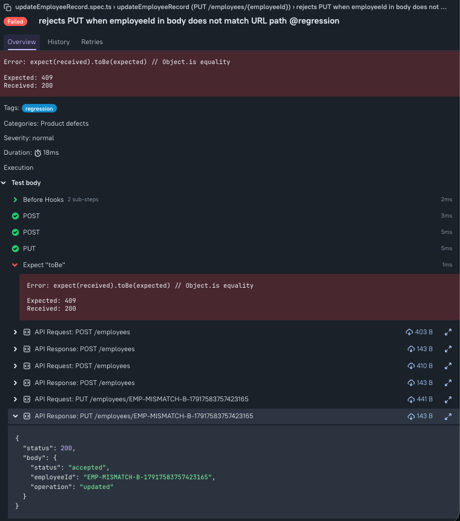

# Bug Title

PUT `/employees/{employeeId}` accepts mismatched body `employeeId` and risks cross-record update

## What happened vs expected

- **Actual:** API accepted a `PUT` where URL `employeeId` and body `employeeId` were different, and processed the update.
- **Expected:** Request should be rejected (`409` or `400`) when path/body `employeeId` mismatch is detected; no records should be updated.

## Repro steps

1. Create employee A  
   `POST /employees` with `employeeId=EMP10001`, `department=Data`.
2. Create employee B  
   `POST /employees` with `employeeId=EMP10002`, `department=Engineering`.
3. Send update to employee B endpoint but with employee A in body:  
   `PUT /employees/EMP10002` body includes `employeeId=EMP10001`, `department=Operations`.
4. Observe API response and downstream DB records.

## Evidence

- Test: `updateEmployeeRecord.spec.ts` (mismatch scenario)
- API response returned success instead of rejection (observed `200` before fix).
- DB validation showed unintended update risk due to identity mismatch acceptance.
- Screenshot:

## Severity / Priority

- **Severity:** High
- **Priority:** High
- **Reasoning:** This is an identity-integrity defect that can update the wrong employee record, impacting payroll/access/reporting trust and creating compliance risk.